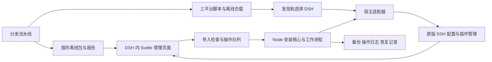
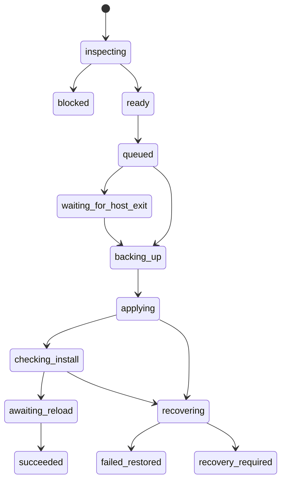

# DSH 离线插件管理器与脚本安装器设计

日期：2026-10-19，Asia/Shanghai。状态：脚本方案已获用户确认，具体契约与实施计划待审阅。本修订替代同日的独立图形安装器方案；不代表安装器已经实现或通过三平台验证。

## 1 目标与已确认范围

用户在已安装 DSH 的电脑上，解压对应平台的安装包，运行安装脚本，在终端菜单中确认目标并安装管理插件。Windows 和 macOS 保留双击入口，Linux 同时提供文件管理器入口与 `sh install.sh`。随后在 DSH 中拖入离线安装包或离线成品目录，点击安装，并能在已安装列表中卸载插件。首次安装会出现终端窗口；日常操作在 DSH 页面内完成。

首版同时设计 Windows、macOS、Linux 的分发和操作路径，沿用 `fatevase/dsh_depot` 作为唯一分发仓库。前端使用 Svelte，保持现有网站已经确认的配色、分类和平台标识；新管理器不改变网站布局。

用户已确认：文件夹仅指已完成构建、包含运行依赖的离线成品目录。普通源码仓库、现场下载依赖、现场编译、Agent 修复、LLM API、在线插件市场、自动升级及 DSH 内核修改不在首版范围。已筛选的 99 个候选仓库不自动进入收录或批量构建。

成功分为两个阶段：安装器确认包已安装、配置可合成；DSH 启动后确认管理入口及目标插件已加载。安装完成但尚未加载，必须显示“已安装，等待重启验证”，不能提前显示“已启用”。

## 2 方案选择

| 方案 | 适用性与代价 | 决定 |
| --- | --- | --- |
| DSH 内管理插件加三平台脚本 | 入口小，运行本地离线包，共享安装核心；脚本也承担退出宿主后的修复与自身维护 | 采用 |
| DSH 内管理插件加独立图形安装应用 | 可以隐藏终端，但需要额外分发桌面运行时、处理应用签名和平台安装格式 | 后置，首版不构建 |
| 修改 DSH 内核或要求内核增加专有安装协议 | 可获得更深的集成，但需要跟随宿主发布，无法作为当前方案的前提 | 不采用 |

三平台脚本只做定位自身目录、选择可用 Node 和启动共享核心，不各自实现 JSON 解析、依赖分析和回退。共享核心采用纯 JavaScript；界面继续在 DSH 中使用 Svelte。首版不新增 Electron、Tauri、WebView、GUI 安装应用、后台系统服务或登录启动项。

提供完整离线包与轻量包。完整包附带官方 Node `26.9.0` 的必要运行文件、许可证及校验记录，默认用于没有独立 Node 的桌面用户；不包含第二套 DSH、npm、编译器或浏览器。轻量包不附带 Node，接受 `^22.19.0 || >=24.0.0` 的已安装独立 Node；缺失时停止并引导使用完整包，禁止临时联网下载。完整包优先使用包内已核对的 Node；轻量包固定本次选定的绝对路径，不在操作中重新查询 PATH。

官方桌面端有自己的 Node 环境不代表公开提供任意脚本执行器，不通过私有 Electron 环境变量借用它。安装核心的 Node 与实际执行插件的宿主 Node 可以不同，必须分别记录和核实。

## 3 总体结构

| 模块 | 职责 | 不承担的职责 |
| --- | --- | --- |
| 管理页面 | 拖拽、选择文件、预览、列表、确认操作及展示结果 | 不直接读写宿主目录、不拼接命令 |
| 管理插件宿主端 | 从实际宿主取得环境、鉴权、接收导入、查询状态、挂载页面 | 不把网页传来的路径当成已授权宿主路径 |
| 安装核心 | 解析包、校验条件、生成不可变操作计划、收据与恢复决定 | 不猜测 DSH 私有内部结构 |
| 宿主适配器 | 定位当前配置、调用宿主公开操作、处理锁与加载状态 | 不用安装器的 Node 版本替代宿主版本 |
| 脚本入口 | 打开终端菜单、选择环境、安装管理插件、修复及自身维护 | 不复制三份安装业务逻辑，不接管 DSH 更新 |
| 独立工作进程 | 执行包操作、维持日志、处理取消及崩溃恢复 | 不在被卸载的插件模块中执行自身更新 |
| 分发流水线 | 生成运行包、包内清单、验证报告和平台安装器 | 不在用户机器上补编译 |

新增代码统一放入 `distribution/manager/`，包含 `core/`、`plugin/host/`、`plugin/client/`、`bootstrap/`、`worker/`、`adapters/`、`contracts/` 和 `fixtures/`。这些是设计目录，本次不创建产品代码。该位置随现有分发仓库导出，避免再增加目标仓库。

## 4 平台范围与安装包形式

首轮目标沿用现有分发标识。下列系统版本为拟验收基线，只有实测通过后才进入发布清单；不把 CI runner 的名称当成终端用户系统兼容声明。

| 平台标识 | 首轮验收环境 | 脚本入口 | 用户流程 |
| --- | --- | --- | --- |
| `win32-x64` | Windows 11 x64 | `install.cmd`；可选 `install.ps1` | 解压 ZIP，双击 CMD，显示终端菜单并启动 Node 核心 |
| `macos-arm64` | macOS 14 及以上 Apple Silicon | `install.command`，调用共用 `install.sh` | 解压 tar.gz，双击已保留执行权限的 command；也可运行 `sh install.sh` |
| `linux-x64` | Ubuntu 24.04 x64 与 Fedora 43 x64 | `install.sh` | 解压 tar.gz，允许执行脚本的文件管理器可启动，统一提供 `sh install.sh` 入口 |

Windows 10、macOS Intel、Linux arm64、Windows arm64、Linux musl 不在首轮支持声明中。Linux 脚本支持本地终端与 SSH 交互终端；管理页面通过 DSH Web 访问，不再要求安装机器具有图形桌面。宿主自身的启动要求仍独立适用。

双击只保证在所验收系统中打开终端安装菜单，不保证绕过 OS 首次打开提示。Unix 归档保留 `0755` 执行权限、脚本使用 LF；CMD 使用明确的 Windows 换行约定。Linux 文件管理器可能只打开编辑器，此时按指南运行 `sh install.sh`；不宣称所有 Linux 桌面都支持双击执行。

默认 CMD 直接启动包内或已选择的 Node，不需要 PowerShell `.ps1` 执行权限。可选 PS1 使用 Windows PowerShell 5.1 兼容语法并遵守本机策略；不传 `ExecutionPolicy Bypass`、不自动 `Unblock-File`、不更改组策略。Unix 不自动清除 quarantine、不自动使用 sudo、不修改用户 shell 启动文件。

完整包的 Linux Node 运行时仍有 libc 和系统库要求，报告记录实际基线，不静默下载系统依赖。全部插件操作以目标配置的普通用户身份执行；root 或身份不匹配时停止，不向 root 的 HOME 或其他用户配置误装。

首版直接提供“程序＋运行时＋启动脚本＋说明文件”的压缩包。Windows 为 `dsh-depot-manager-0.1.0-win32-x64-full.zip`，macOS / Linux 为对应平台的 `dsh-depot-manager-0.1.0-<平台>-full.tgz`；轻量包使用 `-lite`，不拼哈希。解压内容包括对应入口、打包好的 `core.mjs`、`manager.tgz`、`bundle.json`、`payload.sha256` 和 `README.txt`，完整包另含 `runtime/` 与许可证。用户直接运行 CMD / command / sh，不需要安装依赖或编译。首版不引入 SEA、Rust 或桌面 UI 外壳。

`bundle.json` 使用 schemaVersion=1，固定 version、target、flavor、entrypoints、coreVersion、manager 的文件/包名/版本/sha256、runtime 的来源/版本/文件摘要，以及不包含自身的负载索引。最终归档 SHA-256 在发布报告中记录。启动包内 Node 之前，Unix 使用系统 sha256sum 或 shasum，Windows 使用系统哈希命令核对该可执行文件；缺少必要工具时清晰停止，不能先执行待核对的 Node 再用它为自身证明完整性。默认 CMD 可调用固定的 PowerShell Get-FileHash 命令，但不把 PS1 内容读取后当 Command 执行来绕过策略。

菜单固定为安装或修复、从本地包更新、卸载管理器、检查或恢复、退出；危险操作均展示目标再确认。共享命令接口为 `bootstrap.mjs menu|inspect|install|update|remove|recover|status`，接收 `--host-id`、`--package`、`--package-name`、`--action`、`--operation-id`、`--json`；inspect 的可选 action 用于生成预览计划，不变更目标配置。非交互写操作必须携带已核对的 `--plan-id`，无输入时不能默认选择首个 DSH 执行。

## 5 宿主识别与能力约定

### 5.1 事实基线

当前项目锁定 `@deepseek-ai/dsh@0.2.0-rc.2`，分发验证使用 Node `26.9.0`。现有流水线已通过原版 DSH 的本地 `.tgz` 安装路径验证，使用 `--offline --ignore-scripts`。这证明当前 Web 验证环境的安装能力，不证明任意官方桌面端或第三方封装均可使用同一命令。

本地 CLI 的 `parseDshArgs(argv, version, manageDesktopProfile=false)` 对桌面配置有专门限制。此前把这一限制简单归为“新旧版本差异”并不准确：官方桌面端自带命令与 npm 安装命令的所有权和权限也不同。

官方桌面文档说明：自带命令可在应用已初始化且完全退出后管理桌面插件；npm 安装的 DSH 不能据此修改桌面插件目录。公开的 `dsh://open` 用于唤起窗口，不作为安装协议。实际支持范围必须绑定发布版本与安装来源，不能仅根据上游 master 文档开放写入。参见[官方桌面命令与安装所有权](https://github.com/deepseek-ai/deepseek-harness/blob/687f282e8625c6b8d11ff58211a90524be2e4317/apps/desktop/README.md#bundled-command-runtime)。

### 5.2 环境记录

每个候选环境生成 `hostId`，并记录以下字段：

- 安装类型：`cli-web`、`official-desktop` 或尚未适配的桌面封装；宿主安装路径、配置目录、配置名称和目录所有者。
- DSH 版本、宿主可执行文件及其来源、可用的包管理器入口、启动入口、运行与锁状态。
- 宿主实际 `platform/arch`、Node 版本、Node ABI、Node-API 版本，以及 Linux libc 类型和可识别的版本。
- 能力：本地包安装、离线模式、禁用脚本、卸载、持有写锁的操作边界、兼容性检查、启动检查、优雅退出和重新打开。

支持矩阵按“安装类型、宿主版本、运行时、系统”列出已验证的适配器版本；安装器内置一份矩阵，离线读取。能力探测只使用公开且只读的入口。禁止通过试装一个包来判断宿主是否支持安装。

没有足够信息时显示“尚不能确认此环境支持离线安装”，禁用执行并提供具体原因。不能为了绕过桌面限制调用其内部模块、复制模块进入签名应用，或伪造宿主启动标志。

### 5.3 发现顺序

Windows 检查明确的应用安装记录、当前用户常见安装位置及 PATH；macOS 检查应用登记和用户、系统应用目录；Linux 检查桌面入口、已安装包记录及 PATH。只读取相关位置，不扫描全盘或搜索用户业务文件。

自定义 `DSH_HOME`、便携版和多套安装可通过“选择 DSH”或“选择已有配置目录”补充。目录必须与宿主提供的信息对应。唯一、已确认且兼容的环境可自动选中；多份环境必须明确选择。不能默认把所有客户端都指向 `~/.dsh/profiles/web`。

从 DSH 内启动的管理器以实际运行宿主提供的当前配置为唯一写入目标，不允许在网页请求中另传任意配置目录。外部安装器可选择不同环境，但每次操作计划固定绑定一个 `hostId`。

### 5.4 运行时匹配

包与 DSH 的实际运行架构匹配，不仅匹配物理 CPU。例如 ARM 电脑上的 x64 宿主不能使用 arm64 原生插件。检查 DSH peer 依赖、Node engines、Node ABI 或 Node-API、libc 和原生依赖条件。

安装核心使用的独立 Node 只用于解析、复制、哈希及任务协调，不能代替宿主执行原生模块探针。产品目标只使用 `macos-arm64`，不接受旧 `darwin-arm64` 目标别名；Node API 及 npm 标准 `os` 字段中的 `darwin` 是上游运行时字段，不是产品别名。

## 6 首次安装流程

1. 解压并运行对应脚本，进入终端菜单。完整包使用包内 Node，轻量包检查既有 Node；不联网补依赖。
2. 读取本地管理器包及校验清单，检查 bundle.json 和各文件哈希；失败则停止。
3. 发现 DSH，显示应用来源、版本、配置名称和目录；多份必须选择，未找到时提供路径选择说明，不自动另装 DSH。官方桌面未初始化时提示先打开一次。
4. 显示计划，用户输入确认后固定 hostId、管理器版本、包哈希和变更。相同版本及哈希跳过；同版本不同哈希明确显示替换。
5. 将已核对的脚本和核心保存在当前用户数据目录，登记运行时。完整包保存对应 Node，轻量包记录所选 Node 的绝对路径与身份；不要依赖下载目录永久存在。
6. 按适配器要求等待 DSH 完全退出。关闭窗口但托盘仍运行不算退出；不强杀、不打断任务。终端可等待，也可保存计划供下一次运行继续。
7. 按第 11 节备份、安装、检查配置，失败恢复，成功显示“已安装，等待启动验证”。
8. 经用户确认可重开同一 DSH 环境。Web 使用实际启动返回的地址，不猜端口，不记录启动 token；SSH 上只显示目标服务信息，不尝试打开用户本机应用。
9. 管理插件宿主端生成绑定任务、配置和版本的加载回执，DSH 显示“离线插件”入口。终端收到回执后显示完成，关闭终端后可通过脚本 status 或页面查询。

启动后 60 秒未收到回执显示“已安装，尚未确认加载”，提供重新打开、诊断与恢复菜单，不重复安装。慢启动不触发破坏性回退；明确由本次变更造成的启动失败在状态仍可安全回退时恢复。

## 7 DSH 内页面与交互

管理器使用一个宿主提供的独立页面入口，不依赖 Better Sidebar 或其他第三方插件。若宿主入口要求 React 注册，用最小宿主适配层挂载独立 DOM 容器，页面主体仍由 Svelte 渲染并负责销毁；不引入 React 页面重写，不重复打包宿主运行库。

| 区域 | 内容与操作 |
| --- | --- |
| 环境栏 | 当前 DSH、配置名称、宿主版本、运行架构及是否等待重启 |
| 导入区 | 拖拽提示、“选择安装包”“选择离线目录”；多项导入进入待安装列表 |
| 待安装列表 | 名称、版本、平台、兼容结论、验证状态、来源、大小和安装或替换动作 |
| 已安装列表 | 搜索、版本、来源、当前是否加载、待重启状态、卸载入口 |
| 操作记录 | 进度、结果、失败原因、重试或恢复入口、脱敏诊断导出 |

默认打开已安装列表；没有插件时显示导入入口和本地使用说明。拖入有效包后展开安装预览，用户点击“安装”才执行包操作。批量一次确认，逐包展示结果。

页面沿用现有产品的浅色、蓝色强调和规整信息布局，状态同时有文字和颜色。绿色表示匹配证据下的验证通过，琥珀色表示未验证或等待加载，红色表示不兼容或失败。详情中明确“包未验证”“文件未核验”“安装未完成”和“尚未加载”的不同含义。

只列出当前配置中的插件包，不把其全部传递依赖显示成数百个可卸载插件。宿主内置包显示“宿主管理”，不给普通卸载按钮。来源不明的既有插件仍可列出真实安装信息，不编造 Depot 版本或验证记录。

首版不提供“清空全部数据”、自动更新、后台常驻托盘或启动登录项。管理器自身的更新与移除在退出 DSH 后运行脚本处理。

## 8 离线包与成品目录约定

### 8.1 标准安装包

沿用可被原版 DSH 接受的标准 npm `.tgz`，不另发明替代 npm 的运行格式。包内包含 `package.json`、DSH 声明和构建结果、静态资源、运行依赖、许可证，以及新增的 `depot-manifest.json` 和 `depot-files.json`。

`depot-manifest.json` 必须包含：协议版本、实际 npm 包名与版本、展示 ID、产品目标、DSH 与 Node 要求、宿主 peer 依赖、原生运行时约束、来源仓库及 commit、recipe/buildKey、文件清单 SHA-256。构建证据记录验证时使用的宿主与运行时，不自行推导更宽兼容范围。

| 字段 | 首版契约 |
| --- | --- |
| `schemaVersion` | 整数 `1`，未知版本明确拒绝，不猜测降级解析 |
| `package` | `name`、`version` 与 npm manifest 一致；`recipeId` 为分发展示 ID |
| `target` | 三个既有产品目标之一，单包单目标，不用 `all` 绕过匹配 |
| `compatibility` | `dshRange`、`nodeRange` 与 `hostPeers`；已验证环境以独立 `testedEnvironments` 列出 |
| `native` | `present` 为布尔值；为真时给出 `nodeAbi` 或 `napiMinimum`、`runtimeKinds`、系统约束；Linux 另含 `libc` 与测得的最低版本 |
| `source` | 仓库、完整 commit SHA、源码归档 SHA-256，绑定实际构建输入 |
| `build` | buildKey、recipeDigest、工具链与打包器版本 |
| `filesSha256` | `depot-files.json` 原始字节的 64 字符小写十六进制 SHA-256 |

`testedEnvironments` 不意味着其他环境一定兼容；缺少某个原生运行时约束时不能把其范围解释为无限制。纯 JavaScript 包也只显示实际验证过的范围。

`depot-files.json` 记录其余负载文件的相对路径、类型、大小、SHA-256、允许的执行权限及安全内部链接。清单不列自身；包内主清单通过文件清单哈希关联负载，最终 `.tgz` 哈希由包外发布清单记录，避免自引用哈希。

发布验证结论位于包外报告，绑定最终 `.tgz` SHA-256、环境和验证范围。验证结束后不把新状态写回 `.tgz`，否则将改变已经验证的字节。包内声明不能自行证明“验证通过”。

### 8.2 成品目录

支持拖入 `.tgz` 解压后的单个包根目录，允许外层只有一个 `package/` 包装目录。其内容与标准安装包一致。多包集合目录、源码 workspace、只有源文件的仓库、缺少运行依赖的目录均返回具体原因；不递归猜选一个子项目执行安装。

从浏览器导入目录时保留相对路径，将内容流式写入受控暂存目录。目录选择或拖拽不可用时提供选择 `.tgz` 的替代入口。远程访问 DSH Web 时，上传内容送到运行 DSH 的机器；页面明确显示该目标，不能把浏览器电脑的文件路径当成服务器本地路径。

pnpm 开发目录中的外部符号链接、链接到目录外的依赖、依赖原位置的 `file:/link:/workspace:` 引用不属于可移植成品。流水线导出的目录必须拥有完整负载；内部链接依据文件清单验证并重建，原生可执行权限仅按清单中允许的普通权限恢复。无法保留链接或权限且无法重建时拒绝该目录，不伪装成成功导入。

目录安装前在暂存区生成临时 `.tgz`，按照同样的包检查和安装流程处理。原目录始终不改动；生成的新包记录新哈希，不继承原压缩包的验证通过标签。

### 8.3 既有包与第三方包

现有发布包不保证已经包含新增的包内清单。安装器可内置已核实历史包的精确哈希与身份记录；字节匹配时展示已有验证范围。不能仅因文件名与网站相同就认定属于历史包。

对没有 Depot 清单的标准 npm 离线包和成品目录，先静态读取身份、DSH 声明、依赖与平台约束，展示“第三方包，未核验”。能确定的不兼容直接拒绝；缺少可确认的平台或完整性信息时，在预览中要求用户明确选择继续尝试，且必须执行空缓存离线解析检查。这个结果只证明对应检查完成，不获得发布来源或全面运行验证标签。

不把未知平台默认为“通用”。无法满足依赖闭包、需要下载或安装脚本才能生成运行文件的包拒绝安装。用户可继续使用原版 DSH 自有安装方式，但管理器不会为此临时联网或开启脚本。

### 8.4 校验与状态

校验分成三项独立展示：文件完整性、发布来源、运行验证。自己提供的 SHA-256 或包内清单只能用于一致性检查；不能将其称为可信发布者认证。安装器内置的发布索引随安装器整体分发；外部更新索引需验证发布签名，签名体系未完成时首版不启用在线更新索引。

官方站点允许下载未验证包的既有政策保持不变。完整性错误、身份冲突、明确不兼容、已知撤回属于阻断；构建完成但验证缺失属于琥珀色，可由用户在预览明确选择尝试。离线仅能知道内置或已导入索引中的撤回状态，不能宣称掌握最新撤回信息。

## 9 导入检查与依赖处理

检查顺序为文件类型与限制、归档路径、静态身份、文件清单、宿主与目标、生产依赖闭包、现有安装冲突。读取元数据不导入插件 JavaScript，也不执行 `prepare/install/postinstall`。

解包在 JavaScript 工作进程完成，不假定终端用户安装 Python、tar、Git 或编译器。需要拒绝绝对路径、路径穿越、越界链接、设备文件、命名管道、重复文件、Windows 设备名、大小写碰撞及系统无法表示的路径。解包写入前与写入时均校验目标，不通过符号链接写到暂存区外。

首版单个压缩包上限 512 MiB，单包展开上限 2 GiB、100000 条目和 64 层目录；每批最多 20 个顶层导入项。大文件流式处理，累计字节超限立即停止。目录同样执行展开限制；磁盘预估包含临时包、安装后新增内容和完整恢复快照，空间不足时在变更前拒绝。

运行依赖必须包含在包中，或明确由选定 DSH 宿主作为 peer 提供。禁止为了满足 peer 从网络安装另一份宿主核心包。包管理器离线解析在独立空 store 和临时配置中进行，原生模块最终在真实目标运行时验证。

导入检查可以并行两个任务；同一配置的安装、替换、卸载串行。不同配置互不复用任务状态或 store。离线选项和关闭脚本是必要配置，冷缓存与 OS 级断网测试才是“无需外网”的发布依据；不在用户电脑修改防火墙来模拟 CI 验证。

## 10 安装计划与状态接口

前端提交的是暂存项 ID 和用户选择，不提交任意命令、环境变量或工作目录。核心生成计划并返回 `planId`、版本摘要、目标环境、包哈希、预计变更、检查结论和备份要求。执行前再次核对包字节、当前配置指纹、宿主身份和计划有效期。

计划 15 分钟过期；宿主切换、文件改变、已安装版本变化或目标目录重新指向其他位置均使计划失效。上传完成后封存暂存项，后续上传不能改变已有计划指向的字节。点击执行后持久化任务，任务可超过 15 分钟，不因预览过期中断执行。重复提交同一个计划返回已有任务，不重复安装。

建议宿主侧接口如下，传输可适配宿主公开 RPC；这里定义操作语义，不绑定不存在的 DSH API：

| 操作 | 输入 | 输出 |
| --- | --- | --- |
| `environment.current` | 无 | 当前宿主与能力，敏感路径仅返回必要部分 |
| `imports.create/upload/finish` | 文件与相对路径、受限上传标识 | 暂存项与静态检查结果 |
| `plans.create` | install/replace 使用暂存项；remove 使用已安装 packageName 与安装指纹；均固定 action 和风险选择 | 不可变操作计划 |
| `operations.start` | planId、幂等请求 ID | operationId |
| `operations.status/events` | operationId、事件游标 | 可恢复的进度和结果 |
| `operations.cancel` | operationId | 已取消、停止后恢复中或当前不可中断 |
| `installed.list` | 查询条件 | 当前配置的插件列表 |
| `recovery.inspect/restore` | operationId、恢复计划确认 | 恢复结果及仍需处理的事项 |

所有修改沿用宿主鉴权、同源限制与用户动作约束。上传会话和暂存 ID 与当前用户、宿主配置绑定。插件页面不暴露任意文件系统或包管理器参数。不增加 Electron preload 或浏览器原生桥。脚本只传受限参数，不使用 eval、curl 管道执行或包元数据提供的命令。

## 11 操作执行与失败恢复

### 11.1 独立工作进程

安装核心从插件目录之外的稳定用户目录运行，采用经校验的独立 Node；首装和管理器自身更新、移除由外部终端脚本执行，先完成所需的 DSH 退出。不得指望被卸载的插件继续执行自身维护。

普通安装可由页面交接给 Node 工作进程，使用受限 IPC、独立日志和任务锁。spawn/fork、detached/unref 不自动证明能跨宿主退出存活；尤其 Windows Job Object 需要实测。只有已通过存活验收的适配器才允许跨退出自动继续，其他情况显示“退出 DSH 后运行安装脚本继续”，保存计划且不提前变更。参见 [Node 子进程约定](https://nodejs.org/download/release/v26.9.0/docs/api/child_process.html#optionsdetached)。

交接使用 OS 用户私有目录内的任务文件与本地管道。校验目录权限、对端、随机一次性口令、hostId 和任务摘要，任务不能指定任意命令或目标目录。加载回执由管理插件宿主端生成并绑定相同信息，网页不能只凭 operationId 冒充已加载；口令不写日志或 URL。

手工只装 .tgz 的用户可以查看列表和静态检查；具备完整宿主事务能力时允许普通操作，否则提示先使用脚本包。脚本登记稳定工具目录和运行时身份，不自动下载工具。从 OS 双击入口或独立系统终端启动的脚本可与 DSH 分离；从 DSH 内置终端或页面发起的进程则必须经过独立存活验证，不能混同。

### 11.2 状态机

未开始变更时取消，删除暂存引用并保留原安装；开始变更后取消，先终止包操作及其子进程，待文件锁释放再恢复。不能把“前端停止等待”当成安装已取消。工作进程或终端崩溃后，下一次打开页面或重跑脚本识别未完成任务，在恢复前禁止同一配置新写入。首版没有常驻守护进程，不宣称断电后自动恢复。

### 11.3 锁与备份

每次操作先取得管理器自己的配置级任务锁，再通过适配器取得与原版宿主包操作一致的写锁。不得持有一个宿主锁后再调用会重复申请同一把锁的高层方法。当前宿主公开的 `runProfilePnpm` 要求调用方已经持锁；若采用该接口，适配器必须按其公开契约在锁内完成备份和操作。

写锁覆盖的事务边界、桌面进程退出条件及与官方管理页面并发时的行为必须纳入适配器验收。适配器不能提供该边界时，采用已验证的“宿主完全退出后执行”方式；两条路径都不可用时禁用执行，不使用自行改配置的旁路。

备份保存配置声明、锁文件、将改动的激活记录，以及恢复原有安装所需的完整插件依赖图。不能仅备份 package.json 和 lockfile 后声称可以完整恢复，也不能把与现有目录共享可变内容的硬链接当成独立备份。原样保存安全内部链接，优先使用具备隔离语义的复制，回退为完整复制。

配置之外的会话、账号、工作区和插件业务数据不纳入普通卸载或回退范围。若外部进程在操作期间改变了本次涉及文件，恢复先比较指纹，不能覆盖他人的新修改。

### 11.4 应用与检查

在锁保护的已确认入口执行本地包安装或移除，关闭联网解析与生命周期脚本。配置只做宿主定义的增量变更，保留其他插件及用户未涉及的字段。包本身不允许自定义包管理器参数。

安装完成后检查身份、依赖落盘及配置合成，再根据适配器能力进行加载或进入等待重启。实时加载只对具有公开加载契约且完成恢复验收的适配器开放；否则显示“安装并在重启后生效”，不能把刷新网页等同于重启 Host。

恢复分为“变更未开始”“已恢复配置和依赖”“需要人工处理”。恢复失败时保留快照、包和日志，给出具体位置及脚本的检查或恢复菜单，DSH 尚能启动时也提供页面入口；绝不以普通失败提示掩盖不完整恢复。

### 11.5 批量与替换

同一包同版本同哈希跳过；同版本不同哈希显示替换；升级和降级在预览展示旧、新版本。批量中同名冲突要求先选择一项，不按导入顺序隐式覆盖。

每个包是独立事务，批量不是全有或全无。某包失败且已恢复，其他独立包可以继续；恢复不完整则暂停该配置的整个队列。用户取消批量时已完成项保留，未开始项取消，正在变更项按取消恢复规则处理。

首版不解析跨独立包的安装顺序来补齐依赖；每个包必须已具备自己的离线运行依赖，例外仅为由目标宿主提供的 peer。

## 12 卸载与管理器自身维护

普通卸载显示包名、版本、当前配置、重启要求与“保留插件设置和数据”。宿主报告内置包、仍被依赖或正在使用时说明原因，不提供强删目录。卸载后核对声明和加载记录，保留缓存不等于卸载失败，首版不自动清理业务数据或共享依赖。

管理器自身更新或移除在退出 DSH 后重跑脚本，选择从本地包更新或卸载。保留旧包与完整恢复数据，失败后可恢复；不在自身请求里先卸载自己再补装，不自动在线升级。

首版不注册 OS 应用卸载钩子，不安装独立桌面应用、系统服务或登录项。脚本工具目录的清理是独立动作：所有登记环境均不再引用、没有执行或未恢复任务时，用户确认后删除工具代码和捆绑 Node。默认保留收据与恢复点，不顺带删除 DSH、账号、会话及业务目录。

## 13 本地数据与保存期限

脚本工具及工作进程使用系统用户数据目录：Windows `%LOCALAPPDATA%/DSH Depot`，macOS `~/Library/Application Support/DSH Depot`，Linux `${XDG_DATA_HOME:-~/.local/share}/dsh-depot`。以工具版本保存不可变代码，以 `hostId` 分隔环境，保存导入内容、任务、快照、加载回执和操作收据。并行运行不能覆盖另一任务正在使用的工具版本。

操作收据至少包括 operationId、计划与包哈希、宿主指纹、开始和结束时间、状态、适配器版本、实际变更、备份引用及检查结果。日志默认不记录账号、环境变量全量、鉴权 cookie 或启动 token。诊断导出预览会说明包含的路径信息，不自动上传。

无任务引用的导入暂存超过 24 小时可清理。每个配置保留最近 3 个成功操作的恢复点，超过 30 天可清理；失败未恢复或正在恢复的快照永不自动清理。清理不涉及插件业务目录。空间不足时先提示可清理项，不删除唯一恢复点后继续写入。

## 14 三平台差异处理

| 项目 | Windows | macOS | Linux |
| --- | --- | --- | --- |
| 入口 | CMD 为默认，PS1 为可选；不因 PS1 被拒就修改策略 | command 包装 sh，归档保留执行位；保留系统首次打开提示 | sh 入口支持桌面及 SSH；不依赖 DISPLAY 或图形安装器 |
| 路径 | 中文、空格、盘符、长路径与 UNC；特殊字符必须保持字面值 | 空格、中文、用户应用目录与外置卷 | XDG、自定义 HOME、noexec、只读挂载 |
| 宿主执行 | 区分 exe 与 cmd，受控启动器负责 CMD 引用规则，不拼接用户 shell 字符串 | 识别应用身份，不猜私有 Node 入口 | 解析已知入口，不把桌面 Exec 文本送 shell 执行 |
| 原生模块 | 按宿主运行时检查 ABI/DLL，占用时等待退出 | 按宿主真实架构检查动态库 | 校验架构、libc 和共享库，musl 单列不支持 |
| 用户身份 | 使用目标配置普通用户，不默认提权 | 不修改系统应用或 shell 配置 | 不使用 sudo，不向 root HOME 误装 |

脚本方案不再以前置签名公证独立应用为要求，但脚本和随附 Node 仍受 OS 策略约束。验收保留下载来源和正常系统设置，不自动去除安全标记。可选 PS1 的签名与执行条件参见 [PowerShell 执行策略](https://learn.microsoft.com/en-us/powershell/module/microsoft.powershell.core/about/about_execution_policies)。哈希仅证明字节一致，不等于发布者认证。

## 15 分发流水线的配套变更

继续同一仓库的发现、判断、构建、验证和发布规则，增加以下产物：

1. npm pack 前生成包内主清单与文件清单，再验证最终字节；不改写已验证包。
2. 管理器构建三个平台 .tgz，配套完整与轻量脚本包。对应包内管理器哈希与报告一致，用户端不执行 npm install 或编译。
3. 构建期获取官方 Node 26.9.0 归档、核对官方发布校验和来源、记录准确哈希并保留许可证；终端用户不下载运行时。
4. 原生 OS runner 测试脚本与冷缓存安装；Windows/macOS 在真实桌面或 VM 验证下载后双击，Linux 在 Ubuntu 24.04、Fedora 43 和 SSH/无 DISPLAY 环境验证。
5. 发布脚本包、管理器包、校验和与兼容性报告，网站仅对真实存在的已核实资产开放入口。

管理器及安装脚本是安装链路基础，只在冷缓存离线安装、卸载与恢复验收通过后提供正常下载；失败产物只保留开发测试附件。普通插件沿用既有未验证包可下载政策，不将其误套为首装脚本可跳过验证。

Actions、Releases、Pages 仍归 fatevase/dsh_depot；平台独立失败与发布。构建无发布权限，分发阶段不执行候选代码。分别记录完整/轻量包的字节、打包及安装时长、恢复时长与磁盘占用，再决定优化或扩展架构。

## 16 网站与指南衔接

首页、搜索页、分类与平台选择保留现有设计，单独增加管理器介绍与下载页面，安装指南仍在指南页面。浏览器平台识别只是建议，用户可手动选择。

下载页默认推荐完整离线包，轻量包注明所需 Node 范围；展示脚本入口、运行条件、适用 DSH 类型、体积和验证范围。区分安装管理器与下载普通插件包，不宣称网站可以直接写本机配置。

三平台指南覆盖解压、对应脚本、终端菜单、Node 条件、多环境选择、目录导入、重启、自身更新卸载与恢复。Linux 同时说明文件管理器差异与 SSH 用法，不推荐通过降低系统安全策略解决安装问题。

## 17 验收矩阵

所有“通过”必须有目标环境、安装器与插件哈希、操作收据、关键日志和相应界面或终端证据；单元测试与 CI 打包完成不能代替真实入口及宿主验收。

| 编号 | 场景 | 通过条件 |
| --- | --- | --- |
| A01 | Windows 首次安装 | 完整包在无独立 Node、空缓存且断外网时双击 CMD，安装并确认入口；PS1 被策略拒绝不影响 CMD 路径 |
| A02 | macOS 首次安装 | 下载解压保留执行位，断网打开 command 并确认入口；不抹去系统首次打开提示 |
| A03 | Linux 脚本 | Ubuntu 24.04 与 Fedora 43 普通用户断网运行 sh，无 sudo、无编译、无 GUI 依赖 |
| A04 | Linux SSH | 无 DISPLAY 的交互终端可安装；浏览器查看实际目标 DSH，不宣称浏览器电脑被安装 |
| A05 | 完整与轻量包 | 完整包不依赖系统 Node；轻量包复用合格 Node，缺失或失效时零配置修改并明确提示 |
| A06 | 多份 DSH 与自定义配置 | 正确列出来源与目录，选择第二份后第一份字节和配置不变 |
| A07 | 桌面所有权限制 | 普通 npm CLI 不修改桌面配置；合法自带入口按退出条件执行 |
| A08 | 未找到与未初始化 DSH | 明确引导，没有生成冒充已有应用的配置或偷偷安装 DSH |
| A09 | 宿主有任务且仍在运行 | 展示等待退出，不强杀进程，不在托盘存活时误判已退出 |
| A10 | 管理器重复安装 | 同版本同哈希幂等；同版本不同哈希需明确替换 |
| P01 | 标准离线包 | 空缓存、断外网、关闭脚本，安装及目标运行时加载通过 |
| P02 | 离线成品目录 | 原目录不变，结构、依赖、权限与内部链接在暂存副本中正确恢复 |
| P03 | 源码与残缺目录 | 缺构建结果或依赖时给出原因，无联网、无现场编译 |
| P04 | 三平台与模拟架构 | 以实际宿主架构校验；Windows/macOS/Linux 混包与 ABI 不匹配被拒绝 |
| P05 | Linux libc 不匹配 | glibc 版本不足或 musl 不被当成通用 linux-x64 |
| P06 | 未验证第三方包 | 显示来源、完整性、运行验证的独立状态；用户明确尝试才执行 |
| P07 | 已验证历史包 | 仅精确哈希命中时显示已有证据；改文件名或改一字节不能冒充 |
| P08 | 篡改与归档攻击 | 路径穿越、越界链接、重名、大小写冲突、恶意包名和超限均在写目标配置前拒绝 |
| P09 | 远程浏览器与不支持目录 API | 目标机器说明正确，上传路径受控，文件选择替代入口可用 |
| T01 | 已有大量插件的配置 | 安装和卸载保持无关插件声明、锁与运行能力，不仅测试空配置 |
| T02 | 原生模块替换及文件占用 | 不以删除占用文件解决冲突；按退出策略完成或安全恢复 |
| T03 | 依赖安装失败与取消 | 子进程结束、锁释放、配置及完整依赖图恢复，收据可核查 |
| T04 | 程序崩溃与断电恢复 | 在备份、应用、检查各阶段模拟中断，下次启动准确恢复或阻止新写入 |
| T05 | 与官方管理器并发 | 使用一致写锁，不覆盖并发变更，无死锁和重复执行；伪造任务及加载回执不能被接受 |
| T06 | 混合批量 | 每包独立结果；已恢复失败不撤销成功项，恢复不完整暂停队列 |
| T07 | 启动失败与加载迟到 | 已安装和已加载分开；延迟不触发破坏性自动回退，明确失败可恢复 |
| U01 | 普通卸载 | 插件声明和加载记录移除，用户设置、工作区及业务数据保留 |
| U02 | 内置包和被依赖包 | 展示不可移除原因，不强删共享运行依赖 |
| U03 | 自身维护 | 退出 DSH 后由脚本执行更新或移除；失败可恢复，工具清理不影响其他环境或未恢复任务 |
| R01 | 离线体验 | 安装器、管理器和所选插件流程无需外网，日志与网络证据一致 |
| R02 | 下载资产 | 网站链接有效、包名简短、哈希一致、签名与验证状态真实 |

## 18 发布前必须实测的边界

- 官方桌面端可分发版本的自带命令位置、离线参数、运行时信息与退出锁；不把 master 文档当最低发布版本。
- 各适配器的持锁备份及操作能力；缺少公开边界则改为退出后运行脚本，仍不具备入口则该组合不开放写入。
- Svelte 独立页面的挂载、销毁、加载回执与三平台原生 DSH 运行时差异。
- 完整包的官方 Node 负载、许可、系统库基线；轻量包的外部 Node 失效处理。
- 下载归档后的 macOS 权限、Windows CMD 特殊字符路径、PS1 策略、Linux 桌面与 SSH 的入口行为。
- Windows 作业限制等退出条件下的工作进程存活，不通过则真实验收“退出后重跑脚本继续”的恢复路径。
- 包内清单、链接、权限经打包与目录上传后保持一致，改变字节不得沿用旧哈希或验证标签。

各平台和宿主组合独立验收、独立公布，其余标为待验证。只有全部目标通过才宣称三平台全面可用；普通脚本执行完成不能替代 DSH 加载验证。

## 19 设计审阅与实施边界

本修订按用户指令改成独立管理插件加三平台脚本，并同步整理实施计划，不另请求一次设计修改授权。本轮交付文档，不创建产品脚手架、不修改线上页面、不触发构建发布。实施前审阅配套计划并确认执行方式。

本地工作区尚无 Git 初始提交，不为文档初始化整个项目或暂存既有未跟踪内容。实施时沿用受控导出至 fatevase/dsh_depot 的分支与审阅流程。

## 20 依据与复核入口

资料日期为 2026-10-19，上游 DSH 核对提交 687f282e8625c6b8d11ff58211a90524be2e4317。机制依据与实际支持范围分开；后者由验收矩阵产生。

- 本地 distribution/lib/package.mjs、verify.mjs：现有标准 npm 离线包、冷缓存安装与平台验证。
- 本地 @deepseek-ai/dsh/lib/bin.js 与 dsh-plugin-manager 的公开 operations.d.ts：桌面所有权、持锁及有限恢复的契约。
- [DSH Desktop 文档](https://github.com/deepseek-ai/deepseek-harness/blob/687f282e8625c6b8d11ff58211a90524be2e4317/apps/desktop/README.md)：桌面自带命令与公开管理路径。
- [Node 子进程](https://nodejs.org/download/release/v26.9.0/docs/api/child_process.html)：CMD 启动和 detached 的边界。
- [Node 26.9.0 发行目录](https://nodejs.org/dist/v26.9.0/)：构建期运行时来源，精确字节与校验值在实现中锁定。
- [PowerShell 执行策略](https://learn.microsoft.com/en-us/powershell/module/microsoft.powershell.core/about/about_execution_policies)：可选 PS1 的执行条件；默认 CMD 不改策略。

审阅重点是终端首次安装、完整与轻量包区别、脚本恢复体验、第三方包尝试规则；本文件不声称实际安装已经完成。
